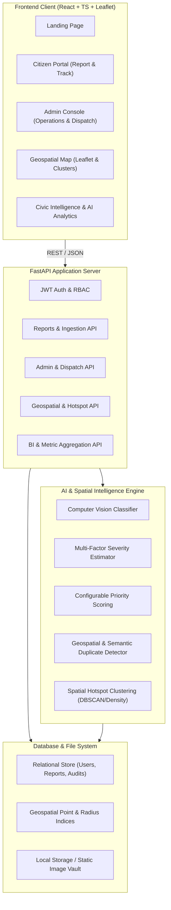

# PROJECT PLAN — CivicPulse AI

## Intelligent Civic Issue Detection, Geospatial Prioritization & Resolution Platform

---

## 1. Executive Architecture Overview

CivicPulse AI is a comprehensive, production-grade civic intelligence and decision-support platform connecting citizens and municipal authorities. It integrates:
- **Client Tier**: Modern React 18 + TypeScript + Vite + Tailwind CSS + Lucide Icons + Leaflet GIS maps + Recharts analytics visualization.
- **API & Business Logic Tier**: FastAPI (Python 3.11) with modular domain architecture, Pydantic v2 schemas, JWT authentication, and dependency injection.
- **Computer Vision & Intelligence Tier**: Modular vision pipeline featuring pre-trained feature extraction, civic classifier for 8 real-world civic categories (Pothole, Road Damage, Garbage Overflow, Illegal Dumping, Water Leakage, Blocked Drain, Broken Streetlight, Damaged Public Infrastructure), explainable severity estimation (1–10), multi-factor priority scoring engine (0–100), and geospatial/temporal duplicate detection.
- **Data & Spatial Storage Tier**: SQLAlchemy 2.0 ORM supporting PostgreSQL + PostGIS (for production containerization) and high-performance geospatial SQLite with spherical Haversine functions (for lightweight, zero-dependency local development on Windows), ensuring rapid and reliable local execution.
- **Workflow & Audit Tier**: State machine enforcing strict municipal status transitions (`Submitted` -> `Under Review` -> `Verified` -> `Assigned` -> `In Progress` -> `Resolved` / `Rejected`), department assignment, resolution evidence uploads, and immutable audit logs.

---

## 2. Core Modules

| Module | Location | Purpose |
|---|---|---|
| **Core & Security** | `backend/app/core/` | Configuration management, JWT token generation/validation, password hashing (bcrypt), structured logging. |
| **Database & Models** | `backend/app/database/`, `backend/app/models/` | Relational schemas for Users, Reports, Categories, Departments, Assignments, AI Predictions, Priorities, Duplicates, Audits. |
| **Computer Vision Engine** | `backend/app/ml/` | Vision inference, feature representation, confidence estimation, model card definitions, and test evaluation metrics. |
| **Severity & Priority Services** | `backend/app/services/` | Explainable 1–10 severity scoring and configurable 5-factor priority formula (Severity, Safety, Location Risk, Community Impact, Issue Age). |
| **Geospatial & Duplicate Engine** | `backend/app/services/` | Spherical distance calculations, duplicate detection scoring (distance + category + time + visual), spatial clustering (DBSCAN/Grid). |
| **Municipal Workflow Engine** | `backend/app/services/` | State machine governing status transitions, SLA calculations, department routing, resolution verification. |
| **Synthetic Data Generator** | `backend/app/database/seed_data.py` | Realistic Bengaluru municipal dataset (150+ realistic simulated civic issues with real coordinates, categories, photos, and duplicate clusters). |
| **Frontend Application** | `frontend/src/` | 10 distinct, responsive views covering citizen submissions, operational dashboards, GIS Leaflet map, details with AI explainability, and analytics. |

---

## 3. Database Schema

Entities & Relationships:
1. `users`: ID, email, password_hash, full_name, role (`citizen`, `admin`), phone, created_at.
2. `categories`: ID, code, name, description, default_department_id, icon, safety_weight.
3. `departments`: ID, name, code, contact_email, phone.
4. `staff`: ID, department_id, name, email, designation.
5. `reports`: ID, tracking_number, citizen_id, title, description, category_id, verified_category_id, latitude, longitude, address, status, image_url, resolution_image_url, resolution_notes, ai_severity, human_severity, priority_score, priority_level, is_duplicate, canonical_report_id, created_at, updated_at, resolved_at.
6. `ai_predictions`: ID, report_id, predicted_category_id, confidence, raw_features, model_name, model_version, inference_time_ms, created_at.
7. `priority_scores`: ID, report_id, severity_component, safety_component, location_risk_component, community_impact_component, age_component, final_score, priority_level, explanation_json, created_at.
8. `duplicate_candidates`: ID, source_report_id, target_report_id, distance_meters, category_match, time_diff_hours, composite_score, status (`suggested`, `confirmed`, `rejected`), created_at.
9. `assignments`: ID, report_id, department_id, staff_id, assigned_by_user_id, notes, status, created_at.
10. `audit_logs`: ID, report_id, user_id, action, previous_state, new_state, notes, created_at.
11. `notifications`: ID, user_id, report_id, title, message, is_read, type, created_at.

---

## 4. REST API Specification

### Authentication & Users
- `POST /api/auth/register` — Citizen registration
- `POST /api/auth/login` — Citizen/Admin login with JWT
- `GET /api/auth/me` — Current user profile & role verification

### Citizen Operations
- `POST /api/reports` — Submit new civic report with image, metadata, and coordinates
- `GET /api/reports/my` — Get authenticated citizen's submitted reports
- `GET /api/reports/{id}` — Get report details & tracking timeline
- `POST /api/reports/{id}/withdraw` — Citizen withdraws pending report

### Admin & Municipal Operations
- `GET /api/admin/reports` — Filterable, paginated report list
- `GET /api/admin/reports/{id}` — Full report detail with AI breakdown & audit history
- `PATCH /api/admin/reports/{id}/status` — Validated status transition with resolution notes/proof
- `POST /api/admin/reports/{id}/override` — Human override of AI category or severity
- `POST /api/admin/reports/{id}/assign` — Assign report to department & staff member
- `GET /api/admin/departments` — List departments and active staff members
- `GET /api/admin/duplicates` — List suggested duplicate clusters
- `POST /api/admin/duplicates/{id}/resolve` — Confirm or reject duplicate link

### Geospatial & Map
- `GET /api/map/reports` — GeoJSON / points with priority, status, category, coordinates
- `GET /api/map/hotspots` — Geospatial clusters with density metrics
- `GET /api/map/nearby` — Radius-based search around latitude/longitude

### Analytics & Reports
- `GET /api/analytics/kpis` — Municipal overview KPIs (Resolution rate, SLA, counts)
- `GET /api/analytics/charts` — Trend, category, priority, and area distributions
- `GET /api/analytics/ai-metrics` — AI confidence distribution, confusion matrix, and accuracy
- `GET /api/analytics/export` — Export reports in CSV / JSON format

---

## 5. Development Phases

- **Phase 1: Foundation & Setup** — Setup backend virtual environment, install requirements, configure FastAPI, database engine, migrations, JWT authentication, and seed data generator.
- **Phase 2: Core Reporting & Ingestion** — File upload handler, image validation, report schema, citizen submission pipeline.
- **Phase 3: Computer Vision & Intelligence Pipeline** — Civic image classification model, feature extraction, explainable severity calculator, priority scoring engine.
- **Phase 4: Geospatial & Duplicate Detection Engine** — Spatial distance index, candidate duplicate scoring, spatial hotspot clustering (DBSCAN/density grid).
- **Phase 5: Municipal Administration & Workflow** — Status transition machine, department/staff assignment, audit logging, resolution tracking with evidence photos.
- **Phase 6: Frontend Application Development** — React + TypeScript + Tailwind UI with 10 production-quality pages: Landing, Login/Register, Citizen Dashboard, Report Submission, Admin Dashboard, Issue Management, Issue Details, GIS Leaflet Map, AI Analytics, and Exports.
- **Phase 7: Testing & Verification** — Pytest suite covering auth, report submission, AI pipeline, priority scoring, duplicate detection, geospatial queries, and status transitions.
- **Phase 8: Documentation & Packaging** — Comprehensive README, Model Card, Dockerfile, docker-compose.yml, and Windows launch scripts.

---

## 6. Acceptance Criteria

1. Backend starts cleanly with SQLite or PostgreSQL; database initializes with migrations and seed data.
2. Citizen can register, login, and submit issues with photo, category, and interactive map coordinate selection.
3. Uploaded image runs through the real computer vision pipeline with category prediction and confidence score.
4. Transparent severity (1-10) and 5-factor priority score (0-100) are computed and explained.
5. Duplicate detection identifies nearby, same-category reports and provides merge suggestions.
6. Admin can filter reports, inspect AI results, override predictions, assign departments, and transition statuses.
7. Leaflet map renders markers color-coded by priority with clustering and popup cards.
8. Real-time aggregated analytics display KPIs, charts, and spatial hotspots from the database.
9. Export endpoint generates real CSV data.
10. All automated tests pass.
