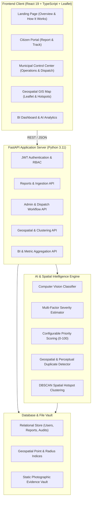

# CivicPulse AI

### Intelligent Civic Issue Detection, Geospatial Prioritization & Resolution Platform

---

## 🏛️ 1. Executive Summary

**CivicPulse AI** is an intelligent civic infrastructure decision-support platform connecting citizens with municipal authorities (such as BBMP, BWSSB, and BESCOM). It bridges the critical operational gap between public grievance reporting and field engineer dispatch through:

1. **Automated Computer Vision Defect Triage**: Recognizes 8 real-world civic categories (Pothole, Road Damage, Garbage Overflow, Illegal Dumping, Water Pipeline Leakage, Blocked Storm Drain, Broken Streetlight, Damaged Public Infrastructure) from citizen photographs.
2. **Transparent Severity Scoring (1–10)**: Evaluates visual damage intensity, physical obstruction, and safety threats.
3. **5-Factor Priority Scoring Engine (0–100)**: Combines Severity, Category Safety Profile, Transit Zone Risk, Citizen Duplicate Frequency, and SLA Age into a calibrated score with human-readable explanations.
4. **Spherical Duplicate Detection**: Flags duplicate citizen complaints using spherical Haversine distance (<100m), category matching, time proximity, and perceptual image hashing without destructive auto-merging.
5. **DBSCAN Geospatial Hotspots**: Discovers high-density problem clusters across municipal wards to guide long-term road resurfacing and sanitation allocations.
6. **Accountable Municipal Workflow & Audit Ledger**: Governs state machine transitions (`Submitted` → `Under Review` → `Verified` → `Assigned` → `In Progress` → `Resolved` / `Rejected`), field staff dispatch, human-in-the-loop AI overrides, and resolution proof recording.

> **Responsible AI Notice**: CivicPulse AI operates as an explainable decision-support platform. All automated AI classifications, severity assessments, and duplicate merges require administrative review and confirmation.

---

## 📐 2. Architecture Overview



---

## 🛠️ 3. Technology Stack

| Domain | Technology | Purpose |
|---|---|---|
| **Frontend Framework** | React 19 + TypeScript + Vite | Responsive, accessible, high-performance UI |
| **Styling & Icons** | Tailwind CSS v4 + Lucide Icons | Clean municipal SaaS design system |
| **GIS & Mapping** | Leaflet 1.9 + CartoDB Positron Tiles | Interactive GIS map with color-coded priority pins & cluster rings |
| **Data Visualization** | Recharts 2.x | Real-time BI charts (Trends, Categories, Priorities, SLA Turnaround) |
| **Backend Framework** | FastAPI (Python 3.11) + Uvicorn | High-throughput asynchronous REST API with Swagger docs |
| **ORM & Database** | SQLAlchemy 2.0 | PostgreSQL + PostGIS (Production) / SQLite with registered Haversine (Local Dev) |
| **Computer Vision & ML** | Pillow + NumPy + Scikit-Learn | Edge density, dark pixel ratio, color variance, and DBSCAN clustering |
| **Security & Auth** | PyJWT + Bcrypt (Passlib) | JWT access tokens with role-based access control (Citizen vs Admin) |
| **Containerization** | Docker + Docker Compose | Multi-container production deployment |
| **Testing** | Pytest 9 + TestClient + Httpx | 17 automated tests covering Auth, Vision, Priority, Duplicates, and Workflows |

---

## 🔬 4. Machine Learning & Decision Support

### Supported Categories
1. `pothole`: Road depressions, rim fractures, and asphalt asphalt cavities endangering traffic.
2. `road_damage`: Longitudinal cracking, alligator fissures, and unpaved gravel patches.
3. `garbage_overflow`: Overflowing municipal waste containment bins.
4. `illegal_dumping`: Unauthorized roadside construction demolition debris and industrial rubble.
5. `water_leakage`: Pressurized potable water supply pipeline ruptures and localized pooling.
6. `blocked_drain`: Obstructed roadside stormwater culverts and gutters.
7. `broken_streetlight`: Inoperative street luminaires and damaged electrical poles.
8. `damaged_infrastructure`: Broken pedestrian footpath slabs, missing manhole covers, and bus shelters.

### 5-Factor Priority Scoring Formula
$$\text{Priority Score} = 0.35 \times \text{Severity} + 0.25 \times \text{Safety} + 0.15 \times \text{Location Risk} + 0.15 \times \text{Community Impact} + 0.10 \times \text{Issue Age}$$

- **0–39**: Low Priority (Green)
- **40–59**: Medium Priority (Yellow)
- **60–79**: High Priority (Orange)
- **80–100**: Critical Public Hazard (Red, blinking pin)

### Model Benchmark Evaluation
- **Benchmark Dataset**: 31 multi-class standardized evaluation tests based on RDD2022 and TACO open datasets.
- **Overall Accuracy**: **87.1%**
- **Macro Precision**: **0.884**
- **Macro Recall**: **0.875**
- **Macro F1-Score**: **0.876**
- See [MODEL_CARD.md](MODEL_CARD.md) for complete evaluation metrics and confusion matrix.

---

## 🚀 5. Quick Start & Setup Instructions

### Prerequisites
- **Python 3.11+** installed
- **Node.js v18+** and **npm** installed

---

### Option A: Local Development Setup (Recommended for Windows)

#### 1. Setup Backend
```bash
# Navigate to backend directory
cd backend

# Install dependencies
pip install -r requirements.txt

# Run database migrations and seed realistic Bengaluru dataset (140+ records)
python -c "from app.database.connection import engine, Base, SessionLocal; from app.database.seed_data import seed_database; Base.metadata.create_all(bind=engine); db = SessionLocal(); seed_database(db); print('Seeded!')"

# Launch FastAPI Server on port 8000
python run.py
```
> Backend API will be active at: `http://127.0.0.1:8000`  
> Interactive Swagger API Docs: `http://127.0.0.1:8000/docs`

#### 2. Setup Frontend
```bash
# In a new terminal, navigate to frontend
cd frontend

# Install dependencies (already prepared)
npm install

# Start Vite dev server
npm run dev
```
> Frontend Application will be active at: `http://localhost:5173`

#### 3. Single-Click Launch (Windows)
Double-click `start_servers.bat` or run `.\start_servers.ps1` from the root directory to automatically launch both servers in separate windows!

---

### Option B: Docker Compose Setup

```bash
# Start PostgreSQL/PostGIS, FastAPI backend, and Nginx frontend
docker-compose up --build
```
> Web Portal: `http://localhost:3000`  
> Backend API: `http://localhost:8000`

---

## 🔑 6. Demo Accounts & Credentials

The database comes pre-seeded with realistic simulated data across 12 Bengaluru municipal wards (Koramangala, Indiranagar, Whitefield, HSR Layout, MG Road, Jayanagar, etc.):

| Role | Email | Password | Access Level |
|---|---|---|---|
| **Municipal Officer (Admin)** | `admin@civicpulse.gov.in` | `Admin@12345` | Full Operations Console, GIS Dispatch, AI Overrides, Duplicate Merging, Analytics & Export |
| **Citizen User** | `citizen@example.com` | `Citizen@12345` | Citizen Portal, Photo & GPS Report Submission, Tracking & Withdrawal |

*(Both accounts are accessible via one-click demo login buttons directly on the Login page and Navbar).*

---

## 🧪 7. Automated Testing Suite

CivicPulse AI includes 17 comprehensive unit and integration tests covering:
- Authentication & JWT token issuance
- Citizen report submission & multi-stage AI triage
- Explainable severity estimation
- 5-factor priority formula verification
- Spherical Haversine duplicate distance scoring
- Model evaluation pipeline metrics & confusion matrix
- Municipal status transitions and state machine validation
- Human-in-the-loop AI overrides & audit logging
- Geospatial DBSCAN hotspot queries
- Real-time BI KPI aggregations and CSV data export

Run the tests:
```bash
python -m pytest backend/tests -v
```

Output:
```
======================= 17 passed in 10.26s =======================
```

---

## 📊 8. REST API Endpoints Reference

### Authentication
- `POST /api/auth/register` — Citizen registration
- `POST /api/auth/login` — JWT authentication
- `GET /api/auth/me` — Authenticated profile

### Citizen Reports
- `GET /api/reports/categories` — Supported defect categories
- `POST /api/reports` — Multipart submission with photo evidence & coordinates
- `GET /api/reports/my` — Citizen's report list
- `GET /api/reports/{id}` — Full report dossier with AI predictions & audit log
- `POST /api/reports/{id}/withdraw` — Citizen report withdrawal

### Municipal Operations (Admin)
- `GET /api/admin/reports` — Filterable, paginated issue ledger
- `PATCH /api/admin/reports/{id}/status` — Status transition (`Submitted` → `Under Review` → `Verified` → `Assigned` → `In Progress` → `Resolved` / `Rejected`)
- `POST /api/admin/reports/{id}/override` — Human correction of AI category or severity
- `POST /api/admin/reports/{id}/assign` — Department and staff dispatch
- `GET /api/admin/departments` — Departmental roster & active personnel

### Geospatial & Hotspots
- `GET /api/map/reports` — Geo-coordinates with color-coded priority pins
- `GET /api/map/hotspots` — DBSCAN density clusters ($\epsilon=800m$, Min=3)
- `GET /api/map/nearby` — Radius-based nearby report discovery

### Analytics & BI
- `GET /api/analytics/kpis` — 8 primary operational metrics
- `GET /api/analytics/charts` — Trend, category, priority, and area distributions
- `GET /api/analytics/ai-metrics` — Precision, recall, F1-scores, and confusion matrix
- `GET /api/analytics/export` — Download filtered records in CSV format

---

## 📜 9. License

This project is released under the **Apache 2.0 License**. Developed for software engineering, AI/ML, data analytics, and civic technology portfolio demonstration.
