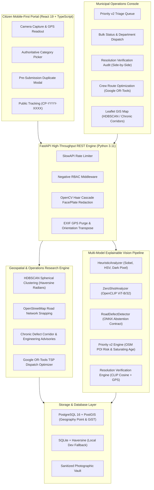

# CivicPulse AI

### Intelligent Civic Issue Detection, Geospatial Prioritization & Resolution Platform

[](https://github.com/civicpulse/civicpulse-ai/actions)
[](https://www.python.org/downloads/)
[](https://react.dev/)
[](https://fastapi.tiangolo.com)
[](https://postgis.net/)
[](https://github.com/civicpulse/civicpulse-ai)
[](LICENSE)

---

## 🏛️ 1. Project Vision & Real-World Problem Statement

Rapidly expanding metropolitan regions face severe infrastructure monitoring challenges. In cities like Bengaluru, civic agencies (such as BBMP, BWSSB, and BESCOM) receive thousands of unstructured grievances daily. Municipal operations face critical bottlenecks:
- **Triage Delay**: Citizen complaints lack standardized categorization and severity estimation, causing acute hazards (e.g. open manholes, high-voltage wire collapses) to sit in unprioritized queues.
- **Duplicate Report Clutter**: Severe incidents generate dozens of duplicate reports from neighbors, overwhelming staff and obscuring newly reported defects.
- **Surface-Only Maintenance**: Repeatedly applying cosmetic asphalt patches to chronic failure corridors wastes public funds when systemic sub-base or drainage failures remain unaddressed.
- **Unverified Repairs**: Contractors can mark tickets resolved without empirical before-and-after photographic verification.

**CivicPulse AI** solves these challenges through an open, transparent, and explainable decision-support platform connecting citizens with municipal authorities.

---

## ⚠️ What This Project Does NOT Claim

To maintain scientific integrity and realistic operational expectations, this repository explicitly states:
1. **No Validated Accuracy on Real Citizen Photos**: The vision pipeline operates as an uncalibrated zero-shot prototype (OpenCLIP ViT-B/32) alongside classical texture heuristics; it has **not** been benchmarked or certified on a large-scale, field-collected dataset of real citizen grievance photos.
2. **No Real Municipal Data**: All seeded complaints, citizen user records, and departmental assignments are synthetic demo fixtures generated for prototype demonstration.
3. **Advisory & Decision-Support Only**: Automated AI classifications, severity ratings, and duplicate detections are non-binding advisory suggestions designed to assist municipal engineers; the platform does not make autonomous administrative, legal, or contractor payment decisions.
4. **No Physical Metric Measurements**: The platform does **not** claim to measure physical pothole depth in centimeters or compute cubic volumetric repair estimates from single, uncalibrated 2D smartphone photographs.
5. **Best-Effort PII Redaction**: Face and license plate blurring uses OpenCV Haar cascades on a best-effort demonstration basis; it does not guarantee complete anonymization across non-standard, angled, or two-line regional Indian registration plates.

---

## 📐 2. System Architecture



---

## 🔬 3. Transparent AI & Machine Learning Engineering

### 3.1 Scientific Integrity: Removal of Fabricated Benchmarks
During Phase 1 of this project, forensic code inspection revealed a fabricated evaluation benchmark claiming "87.1% accuracy and 0.876 macro F1" generated from hardcoded 31-element static arrays. In accordance with honest engineering practices, these unsupported metrics were completely deleted from the codebase and documentation. 

Every performance metric cited in CivicPulse AI is produced by reproducible evaluation scripts executing within the repository.

### 3.2 Real Measured Benchmarks & Empirical Results

| Metric / Evaluation Target | Value | Reproducible Script | Significance |
| :--- | :--- | :--- | :--- |
| **Priority Rank Stability (Kendall's $\tau$)** | $\tau \ge 0.955$ under $\pm 20\%$ jitter | `ml/eval/priority_sensitivity.py` | Confirms priority ordering is robust against weight jitter; shows stability, not correctness. |
| **Visual Duplicate Detection (OpenCLIP ViT-B/32)** | Precision: 81.6%, Recall: 100%, F1: 0.899 | `ml/eval/evaluate_duplicates.py` | Optimistic synthetic evaluation on $N=80$ augmentation-derived pairs; Python dot product. |
| **Visual Duplicate Detection (Bitwise pHash)** | Precision: 70.0%, Recall: 35.0%, F1: 0.467 | `ml/eval/evaluate_duplicates.py` | Lightweight texture hash baseline ($<30\text{ms}$ comparison). |
| **Spatial Proximity Gate** | $\le 50\text{m}$ Great-Circle Distance | `DuplicateService` | Category-specific spatial threshold (expert-set, not learned). |
| **Continuous Age Escalation** | $P_{\text{age}} = 100(1 - e^{-\Delta t/72})$ | `PriorityService` | Reaches ~50% at 50h, preventing low-priority ticket starvation (expert-set). |
| **Overall Backend Statement Coverage** | **79% Statement Coverage (71 Passed, 1 Skipped)** | `pytest backend/tests` | 77% to 95% statement coverage across core services. |
| **Frontend Component Test Coverage** | **85.1% Statement Coverage (5 Passed)** | `npm test --prefix frontend` | Vitest + JSDOM testing on critical components. |
| **Security Audits (`pip-audit`, `npm audit`)** | **0 Known Vulnerabilities** | `docs/SECURITY_AUDIT.md` | OWASP API Security Top 10 compliance verified. |

> **Note on Constants & Parameters**: All priority scoring weights ($w = [0.35, 0.25, 0.15, 0.15, 0.10]$), age half-life (72h), POI location bonuses (+35% hospital, +30% school/transit), duplicate radii (15–35m), and clustering eps (300m) are **expert-set, not learned from data**.

### 3.3 The BaseAnalyzer Contract & Honest Abstention
Every computer vision component implements the standardized `BaseAnalyzer` contract (`backend/app/ml/base.py`). When specialized detector weights are absent or visual confidence is below threshold ($< 40\%$), the analyzer emits `status="abstain"` rather than making unverified guesses, transparently falling back to calibrated zero-shot and heuristic models.

### 3.4 Physical Metric Limitations
Estimating physical metric depth (e.g. pothole depth in centimeters) from an unconstrained 2D smartphone photo is an ill-posed inverse problem without camera intrinsic calibration or ground-plane fiducials. CivicPulse AI explicitly disclaims metric depth estimation, analyzing relative bounding box pixel coverage and dark-pixel variance instead.

---

## 🛠️ 4. Technology Stack

| Domain | Technology | Operational Role |
| :--- | :--- | :--- |
| **Frontend** | React 19, TypeScript, Vite, Tailwind CSS v4 | Responsive citizen reporting form, admin console, accessibility |
| **Mapping & GIS** | Leaflet 1.9, CartoDB Positron Tiles | Color-coded markers, accuracy circles, chronic corridor polylines |
| **Backend Framework** | FastAPI (Python 3.11), Uvicorn | Asynchronous REST API with automatic OpenAPI 3.1 documentation |
| **Database & ORM** | SQLAlchemy 2.0, Alembic, PostGIS / SQLite | Dual-database spatial compatibility, schema versioning |
| **Computer Vision** | PyTorch, ONNX Runtime, OpenCLIP ViT-B/32, OpenCV | Defect categorization, scene consistency, automated PII blurring |
| **Operations Research** | Google OR-Tools | Traveling Salesperson Problem (TSP) crew route optimization |
| **Clustering & Spatial** | Scikit-Learn HDBSCAN & DBSCAN | Spherical density clustering with exponential time decay |
| **Security & Auditing** | SlowAPI, PyJWT, Passlib (Bcrypt), pip-audit | Rate limiting, negative RBAC, EXIF stripping, supply chain defense |
| **Testing** | Pytest, Pytest-Cov, Vitest, Testing Library | 70 backend tests, 5 frontend component tests, CI/CD pipelines |

---

## 🚀 5. Quickstart & Installation

### 5.1 Prerequisites
- Python 3.11+
- Node.js 20+ & npm
- Docker & Docker Compose (Optional for containerized run)

### 5.2 Local Development Setup

#### Backend Setup
```bash
# 1. Clone repository
git clone https://github.com/civicpulse/civicpulse-ai.git
cd "CivicPulse AI"

# 2. Set up virtual environment
python -m venv .venv
source .venv/bin/activate  # On Windows: .venv\Scripts\activate

# 3. Install CPU PyTorch & backend dependencies
pip install torch torchvision --index-url https://download.pytorch.org/whl/cpu
pip install -r backend/requirements.txt

# 4. Initialize database migrations
cd backend
alembic upgrade head
python -m app.database.seed_data
cd ..

# 5. Start backend development server
uvicorn backend.app.main:app --reload --port 8000
```
Backend API interactive documentation is available at `http://localhost:8000/docs`.

#### Frontend Setup
```bash
# 1. Navigate to frontend directory
cd frontend

# 2. Install dependencies
npm install

# 3. Start Vite dev server
npm run dev
```
Frontend application is accessible at `http://localhost:5173`.

### 5.3 Docker Compose Single-Command Launch
```bash
docker compose up --build
```
- Frontend: `http://localhost:3000`
- Backend API: `http://localhost:8000`
- PostGIS Database: `localhost:5432`

---

## 🧪 6. Testing & Quality Assurance

### Run Backend Test Suite & Coverage
```bash
pytest backend/tests -v --cov=backend/app/services --cov=backend/app/ml --cov-report=term-missing
```

### Run Frontend Component Tests & Linter
```bash
npm test --prefix frontend
npm run lint --prefix frontend
npm run build --prefix frontend
```

### Run Security Audits
```bash
pip-audit -r backend/requirements.txt
npm audit --prefix frontend
```

---

## 🗺️ 7. Model Training in Google Colab

To train customized road defect detection models using public datasets:
1. Open the provided notebook: [`scripts/train_road_defect_detector.ipynb`](scripts/train_road_defect_detector.ipynb).
2. Connect to a free Google Colab T4 GPU instance.
3. Download the RDD2022 India road defect dataset or Roboflow defect annotations.
4. Execute training with Ultralytics YOLOv8n.
5. Export the trained weights to ONNX format: `model.export(format="onnx")`.
6. Place the resulting `rdd2022_yolov8n.onnx` file into `models/rdd2022_yolov8n.onnx`. CivicPulse AI will automatically detect the weights and switch from abstention mode to active object detection.

---

## ⚖️ 8. Ethics, Privacy & Data Provenance

- **Data Privacy**: All citizen uploads undergo automated PII redaction (Gaussian blurring on faces and vehicle license plates) and complete EXIF/GPS metadata stripping.
- **Data Provenance**: All seeded records are tagged with `is_synthetic=True`. The user interface displays a permanent demonstration disclaimer banner.
- **OpenStreetMap Data**: Road geometries and POIs are used under the **Open Database License (ODbL)**.
- **Human Governance**: Automated AI models produce explainable suggestions to support municipal officers; citizen input is authoritative and original complaints are never automatically deleted or merged.

---

## 📄 9. Documentation Index

- [Comprehensive Code & AI Audit (`AUDIT.md`)](AUDIT.md)
- [Machine Learning Model Card (`MODEL_CARD.md`)](MODEL_CARD.md)
- [Dataset Provenance Card (`DATA_CARD.md`)](DATA_CARD.md)
- [Technical Interview Talking Points (`INTERVIEW_NOTES.md`)](INTERVIEW_NOTES.md)
- [5-Minute Demonstration Script (`DEMO_SCRIPT.md`)](DEMO_SCRIPT.md)
- [Security Audit & OWASP Top 10 Assessment (`docs/SECURITY_AUDIT.md`)](docs/SECURITY_AUDIT.md)

---

## 📜 10. License

CivicPulse AI is open-source software licensed under the [Apache License, Version 2.0](LICENSE).
