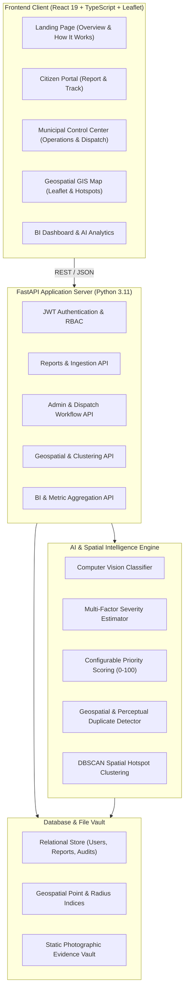

# CivicPulse AI

### Intelligent Civic Issue Detection, Geospatial Prioritization & Resolution Platform

---

## 🏛️ 1. Executive Summary

**CivicPulse AI** is an intelligent civic infrastructure decision-support platform connecting citizens with municipal authorities (such as BBMP, BWSSB, and BESCOM). It bridges the critical operational gap between public grievance reporting and field engineer dispatch through:

1. **Automated Computer Vision Defect Triage**: Recognizes 8 real-world civic categories (Pothole, Road Damage, Garbage Overflow, Illegal Dumping, Water Pipeline Leakage, Blocked Storm Drain, Broken Streetlight, Damaged Public Infrastructure) from citizen photographs.
2. **Transparent Severity Scoring (1–10)**: Evaluates visual damage intensity, physical obstruction, and safety threats.
3. **5-Factor Priority Scoring Engine (0–100)**: Combines Severity, Category Safety Profile, Transit Zone Risk, Citizen Duplicate Frequency, and SLA Age into a calibrated score with human-readable explanations.
4. **Spherical Duplicate Detection**: Flags duplicate citizen complaints using spherical Haversine distance (<100m), category matching, time proximity, and perceptual image hashing without destructive auto-merging.
5. **DBSCAN Geospatial Hotspots**: Discovers high-density problem clusters across municipal wards to guide long-term road resurfacing and sanitation allocations.
6. **Accountable Municipal Workflow & Audit Ledger**: Governs state machine transitions (`Submitted` → `Under Review` → `Verified` → `Assigned` → `In Progress` → `Resolved` / `Rejected`), field staff dispatch, human-in-the-loop AI overrides, and resolution proof recording.

> **Responsible AI Notice**: CivicPulse AI operates as an explainable decision-support platform. All automated AI classifications, severity assessments, and duplicate merges require administrative review and confirmation.

---

## 📐 2. Architecture Overview



---

## 🛠️ 3. Technology Stack

| Domain | Technology | Purpose |
|---|---|---|
| **Frontend Framework** | React 19 + TypeScript + Vite | Responsive, accessible, high-performance UI |
| **Styling & Icons** | Tailwind CSS v4 + Lucide Icons | Clean municipal SaaS design system |
| **GIS & Mapping** | Leaflet 1.9 + CartoDB Positron Tiles | Interactive GIS map with color-coded priority pins & cluster rings |
| **Data Visualization** | Recharts 2.x | Real-time BI charts (Trends, Categories, Priorities, SLA Turnaround) |
| **Backend Framework** | FastAPI (Python 3.11) + Uvicorn | High-throughput asynchronous REST API with Swagger docs |
| **ORM & Database** | SQLAlchemy 2.0 | PostgreSQL + PostGIS (Production) / SQLite with registered Haversine (Local Dev) |
| **Computer Vision & ML** | Pillow + NumPy + Scikit-Learn | Edge density, dark pixel ratio, color variance, and DBSCAN clustering |
| **Security & Auth** | PyJWT + Bcrypt (Passlib) | JWT access tokens with role-based access control (Citizen vs Admin) |
| **Containerization** | Docker + Docker Compose | Multi-container production deployment |
| **Testing** | Pytest 9 + TestClient + Httpx | 17 automated tests covering Auth, Vision, Priority, Duplicates, and Workflows |

---

## 🔬 4. Machine Learning & Decision Support

### Supported Categories
1. `pothole`: Road depressions, rim fractures, and asphalt asphalt cavities endangering traffic.
2. `road_damage`: Longitudinal cracking, alligator fissures, and unpaved gravel patches.
3. `garbage_overflow`: Overflowing municipal waste containment bins.
4. `illegal_dumping`: Unauthorized roadside construction demolition debris and industrial rubble.
5. `water_leakage`: Pressurized potable water supply pipeline ruptures and localized pooling.
6. `blocked_drain`: Obstructed roadside stormwater culverts and gutters.
7. `broken_streetlight`: Inoperative street luminaires and damaged electrical poles.
8. `damaged_infrastructure`: Broken pedestrian footpath slabs, missing manhole covers, and bus shelters.

### 5-Factor Orthogonal Priority Scoring Formula
$$\text{Priority Score} = 0.35 \times \text{Defect Severity} + 0.25 \times \text{Public Safety} + 0.15 \times \text{Location Risk} + 0.15 \times \text{Community Impact} + 0.10 \times \text{Issue Age}$$

To prevent double counting category hazard between severity estimation and priority scoring, factors are strictly separated:
- **Factor 1: Physical Defect Severity (35% weight)**: Measures strictly the mechanical/structural magnitude of the physical defect (1–10 scale mapped to 10–100) based on visual edge density, dark-pixel cavity ratio, and structural degradation descriptors. It does *not* incorporate public safety or accident risk.
- **Factor 2: Public Safety Hazard (25% weight)**: Measures the threat to human life, vehicular safety, and acute bodily hazards (0–100 scale). Inherent category hazard profile is evaluated exclusively here, elevated by acute danger keywords (e.g. live wire, open manhole, collapse).
- **Factor 3: Location Risk (15% weight)**: Transit corridors, schools, hospitals, and arterial junctions (0–100 scale).
- **Factor 4: Community Impact (15% weight)**: Independent citizen report frequency and duplicate cluster density (0–100 scale).
- **Factor 5: Issue Age (10% weight)**: Turnaround SLA escalation over time (0–100 scale).

- **0–34**: Low Priority (Green)
- **35–59**: Medium Priority (Yellow)
- **60–79**: High Priority (Orange)
- **80–100**: Critical Public Hazard (Red, blinking pin)

### Multi-Model Computer Vision Pipeline (Phase 2 Architecture)
CivicPulse AI deploys an extensible, multi-model vision pipeline (`CivicVisionPipeline`) conforming to a unified `BaseAnalyzer` contract:

1. **`HeuristicAnalyzer` (Baseline)**: Classical computer vision extracting normalized Sobel edge gradients, dark cavity depression ratio, HSV variance, and domain keyword matching.
2. **`RoadDefectDetector` (Trained Defect Localization)**: Localized defect detector for asphalt cracking and potholes (RDD2022 classes D00 longitudinal, D10 transverse, D20 alligator, D40 pothole) running via ONNX Runtime on CPU. Abstains honestly when local weights are not deployed.
3. **`ZeroShotAnalyzer` (Vision-Language Generalization)**: OpenCLIP (ViT-B/32) evaluating zero-shot prompts for municipal solid waste, drainage, and infrastructure defects with calibrated confidence thresholds ($\tau \ge 0.35$).
4. **`CivicVisionPipeline` (Authoritative Citizen Selection Policy)**:
   - **Citizen Choice is Authoritative**: The citizen's submitted category is **never** silently overwritten.
   - **Explainable Suggestions**: AI produces suggestions, bounding boxes, and evidence.
   - **Disagreement Routing**: If the AI suggests a different category with confidence $\ge 70\%$, the report is routed to `needs_human_verification` with an explanatory note for municipal review.
   - **Honest Abstention**: If models lack weights or confidence $< 40\%$, the pipeline abstains rather than inventing guesses.

### Training & Deployment (Google Colab T4 GPU)
Because standard development environments lack dedicated CUDA GPUs, a turnkey Google Colab notebook is provided:
- **Notebook**: [`ml/notebooks/CivicPulse_Model_Training_Colab.ipynb`](ml/notebooks/CivicPulse_Model_Training_Colab.ipynb)
- **Anti-Leakage Data Prep**: `python ml/dataset.py` groups dashcam frames by road sequence to prevent consecutive-frame data leakage between train/val/test splits.
- **Reproducible Training**: `python ml/train.py --config ml/configs/rdd2022_yolov8n.yaml --epochs 30 --seed 42 --export-onnx`
- **ONNX Export & Parity Check**: Verifies numeric parity between PyTorch and ONNX Runtime outputs.
- **Local Deployment**: Download `road_detector.onnx` into `backend/app/ml/weights/road_detector.onnx`. The pipeline automatically switches the detector from `abstain` to active mode and overlays bounding boxes on citizen photos!

### Evaluation Suite
- **Detector Evaluation**: `python ml/eval/evaluate_detector.py` computes precision, recall, mAP@0.5, and mAP@0.5:0.95.
- **Out-of-Distribution Bengaluru Benchmark**: `python ml/eval/evaluate_ood.py` benchmarks models against real citizen photos (`data/ood_bengaluru/labels.csv`) with 95% Wilson Score intervals and 1,000-sample bootstrap Macro-F1.
- **Confidence Calibration & Latency**: `python ml/eval/abstention_analysis.py` measures Expected Calibration Error (ECE), risk-coverage curves, and actual local CPU inference latency.
- Detailed metrics and license details are documented in [MODEL_CARD.md](MODEL_CARD.md).

---

## 🚀 5. Quick Start & Setup Instructions

### Prerequisites
- **Python 3.11+** installed
- **Node.js v18+** and **npm** installed

---

### Option A: Local Development Setup (Recommended for Windows)

#### 1. Setup Backend
```bash
# Navigate to backend directory
cd backend

# Install dependencies
pip install -r requirements.txt

# Run database migrations and seed realistic Bengaluru dataset (140+ records)
python -c "from app.database.connection import engine, Base, SessionLocal; from app.database.seed_data import seed_database; Base.metadata.create_all(bind=engine); db = SessionLocal(); seed_database(db); print('Seeded!')"

# Launch FastAPI Server on port 8000
python run.py
```
> Backend API will be active at: `http://127.0.0.1:8000`  
> Interactive Swagger API Docs: `http://127.0.0.1:8000/docs`

#### 2. Setup Frontend
```bash
# In a new terminal, navigate to frontend
cd frontend

# Install dependencies (already prepared)
npm install

# Start Vite dev server
npm run dev
```
> Frontend Application will be active at: `http://localhost:5173`

#### 3. Single-Click Launch (Windows)
Double-click `start_servers.bat` or run `.\start_servers.ps1` from the root directory to automatically launch both servers in separate windows!

---

### Option B: Docker Compose Setup

```bash
# Start PostgreSQL/PostGIS, FastAPI backend, and Nginx frontend
docker-compose up --build
```
> Web Portal: `http://localhost:3000`  
> Backend API: `http://localhost:8000`

---

## 🔑 6. Demo Accounts & Credentials

The database comes pre-seeded with realistic simulated data across 12 Bengaluru municipal wards (Koramangala, Indiranagar, Whitefield, HSR Layout, MG Road, Jayanagar, etc.):

| Role | Email | Password | Access Level |
|---|---|---|---|
| **Municipal Officer (Admin)** | `admin@civicpulse.gov.in` | `Admin@12345` | Full Operations Console, GIS Dispatch, AI Overrides, Duplicate Merging, Analytics & Export |
| **Citizen User** | `citizen@example.com` | `Citizen@12345` | Citizen Portal, Photo & GPS Report Submission, Tracking & Withdrawal |

*(Both accounts are accessible via one-click demo login buttons directly on the Login page and Navbar).*

---

## 🧪 7. Automated Testing Suite

CivicPulse AI includes 38 comprehensive unit and integration tests covering:
- Authentication & JWT token issuance (Citizen vs Admin RBAC)
- Multi-model Computer Vision pipeline & BaseAnalyzer contracts
- Honest abstention when local model weights are absent
- Authoritative citizen selection policy (citizen category never altered)
- AI prediction storage and administrative override feedback tracking
- Bounding box metrics integration with defect severity
- EXIF metadata stripping and orientation preservation (`ImageOps.exif_transpose`)
- Spherical Haversine duplicate distance scoring with bitwise Hamming distance
- Priority formula orthogonality and absence of double counting
- Data provenance tracking (`is_synthetic` flags)
- PostGIS Geography column and GiST spatial index migration
- Geospatial DBSCAN hotspot queries
- Real-time BI KPI aggregations and CSV data export

Run the tests:
```bash
python -m pytest backend/tests -v
```

Output:
```
======================= 37 passed, 1 skipped in 30.51s =======================
```

---

## 📊 8. REST API Endpoints Reference

### Authentication
- `POST /api/auth/register` — Citizen registration
- `POST /api/auth/login` — JWT authentication
- `GET /api/auth/me` — Authenticated profile

### Citizen Reports
- `GET /api/reports/categories` — Supported defect categories
- `POST /api/reports` — Multipart submission with photo evidence & coordinates
- `GET /api/reports/my` — Citizen's report list
- `GET /api/reports/{id}` — Full report dossier with AI predictions & audit log
- `POST /api/reports/{id}/withdraw` — Citizen report withdrawal

### Municipal Operations (Admin)
- `GET /api/admin/reports` — Filterable, paginated issue ledger
- `PATCH /api/admin/reports/{id}/status` — Status transition (`Submitted` → `Under Review` → `Verified` → `Assigned` → `In Progress` → `Resolved` / `Rejected`)
- `POST /api/admin/reports/{id}/override` — Human correction of AI category or severity
- `POST /api/admin/reports/{id}/assign` — Department and staff dispatch
- `GET /api/admin/departments` — Departmental roster & active personnel

### Geospatial & Hotspots
- `GET /api/map/reports` — Geo-coordinates with color-coded priority pins
- `GET /api/map/hotspots` — DBSCAN density clusters ($\epsilon=300m$, Min=3; provisional default tuned on synthetic data, no real-world cluster quality claimed)
- `GET /api/map/nearby` — Radius-based nearby report discovery

### Analytics & BI
- `GET /api/analytics/kpis` — 8 primary operational metrics
- `GET /api/analytics/charts` — Trend, category, priority, and area distributions
- `GET /api/analytics/ai-metrics` — Model evaluation status and confusion matrix
- `GET /api/analytics/export` — Download filtered records in CSV format (requires admin authorization)

---

## 🔒 Security & Production Operational Notes
- **Rate Limiting**: Throttling on `/api/auth/register` (15/min), `/api/auth/login` (20/min), and `/api/reports` (30/min) is enforced via SlowAPI using an in-memory storage strategy. For distributed, multi-worker production deployments (e.g. multi-process Uvicorn / Gunicorn behind Nginx), a Redis-backed storage engine (`limits.storage.RedisStorage`) is required.
- **Privacy & Metadata**: All image uploads have EXIF and GPS tags stripped after orientation normalization (`ImageOps.exif_transpose`) before persisting to disk.
- **Data Provenance**: Seeded demo records are tagged with `is_synthetic = True` across the database and exported files. Genuine citizen submissions default to `is_synthetic = False`.

---

## 📜 9. License

This project is released under the **Apache 2.0 License**. Developed for software engineering, AI/ML, data analytics, and civic technology portfolio demonstration.
